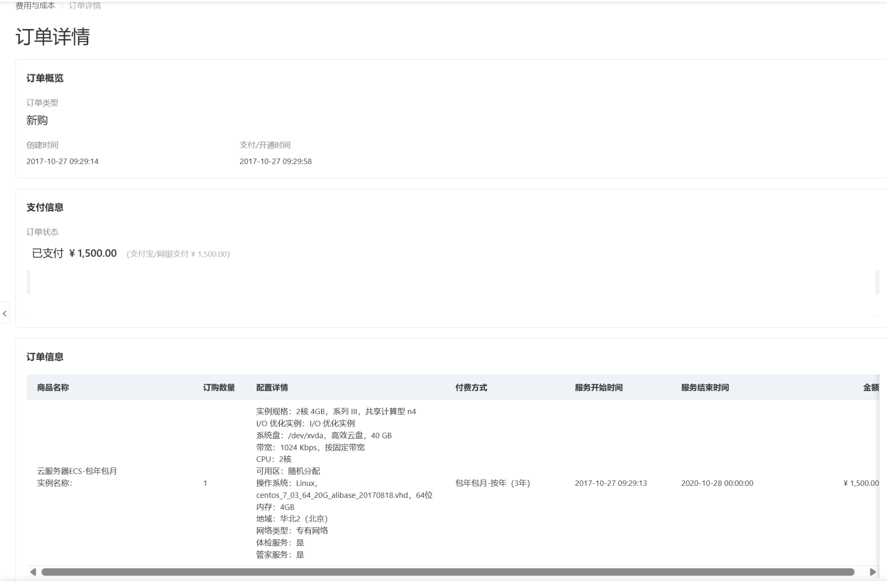
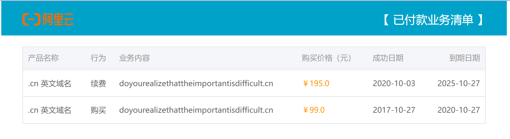
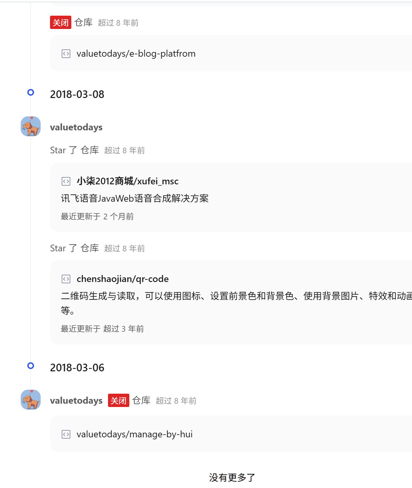
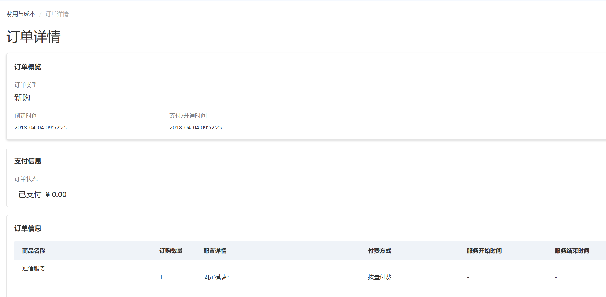

# 我的技术与工具演变记录

回头看过去十多年的开发经历，我发现自己曾经使用过不少技术和工具。有些只是在某个阶段尝试过，有些一直沿用至今，还有一些是在使用多年后，才因为新的问题逐渐被替换。

它们并不是一开始就按某个预先设计好的架构组合起来的。最初只是想把一个程序写出来、运行起来；后来希望能从不同的地方访问；再后来，需要让它持续运行、方便发布、减少服务器开支，也要尽量降低自己维护它的时间。

现在重新梳理这段经历，我更想记录的是：**当时遇到了什么问题，我为什么接触某个工具，以及它后来解决了什么、又带来了什么问题。**

本文覆盖大学时期至2026年的个人技术实践。较早的年份有些来自回忆，未必精确到某个月；能够找到订单、平台动态或 Git 提交的地方，我会把这些材料放在文中。它们是我当年实际行动的记录，而不是为了证明自己多早掌握某项技术。

## 30 秒速览：我为什么使用这些工具

回顾这些年的技术实践，我发现自己接触新工具，大多不是因为它们流行，而是因为当时遇到了某个问题，或者希望把原本复杂的事情做得更简单。

| 我想做什么 | 使用的技术或工具 | 为什么选择它 |
|---|---|---|
| 在不购买额外电脑的情况下运行 Linux | VirtualBox、CentOS 7 | 在本地模拟服务器环境，反复安装、部署和测试 |
| 管理代码历史和多人协作 | SVN（2014年） | 工作需要，避免依赖手工复制文件 |
| 开发 Java Web 应用 | Spring MVC | 公司使用，通过实际项目接触 |
| 让 Java 项目构建更方便 | Ant → Maven | Maven 的依赖管理和标准化构建比原来的 Ant 方案更省事 |
| 减少 Spring XML 配置 | Spring 注解 | 通过《Spring in Action》等资料学习，发现注解方式更简洁 |
| 让自己的程序可以从互联网访问 | 阿里云 ECS、域名（2017年） | 本地虚拟机已经能部署程序，但不能方便地长期对公网提供服务 |
| 在不同电脑间同步个人代码 | Git@OSC / Gitee | 不再依赖本地仓库和文件复制 |
| 减少重复构建和发布 | Jenkins（约2016年） | 将拉取代码、Maven 构建、部署串成自动化流程 |
| 简化 Java 应用开发与运行 | Spring Boot | 减少传统 Spring 项目的配置与独立 Tomcat 部署工作 |
| 让应用环境和部署更容易管理 | Docker、Docker Compose | 减少环境差异，便于独立部署和维护服务 |
| 降低个人 CI 服务的资源占用 | Jenkins → Drone | Jenkins 对个人服务器而言相对较重 |
| 减少 Java 服务的内存占用 | Java → Go | 希望用更轻量的程序运行部分业务；后来因代码复用和维护成本迁回 Java |
| 继续降低 Java 应用资源占用 | Spring Boot → Quarkus | Spring Boot 内存占用成为问题；研究多种轻量方案后最终选择 Quarkus |
| 控制服务器成本和维护复杂度 | 多云服务器、Rocky Linux、1Panel | 比较资源、续费价格、系统兼容性与日常维护成本 |
| 避免再次遗漏 HTTPS 证书到期 | Go、[CertChecker](https://github.com/valuetodays/cert-checker) | 经历过证书过期问题，希望主动检查并提前提醒 |
| 降低旧前端工程的维护成本 | Vue 2 → Vue 3、Codex | 旧依赖和构建配置难以维护，借助 AI 重建工程并迁移页面 |

这些选择并不一定一次就正确。有些技术使用多年后才被替换，有些尝试之后又回到了原来的方案。本文后面记录的，就是这些选择发生的具体过程。

## 一、从安装操作系统开始

在大学时期，我就开始自己折腾电脑系统。最初接触的是 Windows XP、Ghost、各种系统安装盘，后来逐渐学会使用 U 盘安装系统，也接触了 Windows 7。

那时候对“系统”的认识很直接：电脑出问题了，能不能自己解决？想试一个软件，能不能在不影响原来环境的情况下运行？因此我接触了 Virtual PC、VirtualBox 等虚拟机工具。也了解过“影子系统”这种方案，但只是知道有这个东西，并没有真正使用过。

虚拟机后来产生了一个很实际的作用：我可以在 Windows 上准备一台 Linux 机器，不用额外购买硬件，就能安装 JDK、Tomcat、数据库，反复测试 Java Web 项目的运行方式。

2014年前后，我已经学会使用 SVN。工作中开始使用版本控制、Ant、Maven、Spring MVC，也逐渐理解“把代码写完”和“把程序构建、部署、运行起来”是不同的事情。我还购买过 Spring In Action 实体书，自己研究原先不太熟悉的技术。

那几年，我已经在本地虚拟机上部署过 Java 应用。早期确定使用过的 Linux 发行版是 CentOS 7；至于更早是否接触过其他版本，现在记忆并不完整。CentOS 8 则没有使用过，后来直接转向了其他发行版。

## 二、2017年10月27日：第一次购买云服务器和域名

2017年10月27日，是这次回顾中一个很明确的时间点。

我从阿里云历史订单里找到了当天购买第一台 ECS 的记录：**2 核 CPU、4GB 内存、40GB 磁盘，系统镜像是 CentOS 7.3，三年费用1500元。** 同一天，我还买了自己的第一个域名：`doyourealizethattheimportantisdifficult.cn`（该域名已过期），三年99元。

> 说明：2017年10月27日的阿里云 ECS 订单。公开版本遮挡了不需要展示的账号及订单标识。

> 说明：首个域名的购买记录及2020年10月3日的续费记录。

买云服务器之前，我已经成功在本地 Linux 虚拟机里部署程序。所以从技术上说，这不是从零开始：本地使用的 JDK、Tomcat、数据库和 WAR 包，放到 ECS 上仍然是类似的东西。

真正的不同在于，它从一台自己能随时关闭的虚拟机，变成了需要长期对外提供服务的机器。公网 IP、域名解析、安全组、备案、服务器的稳定性和续费成本，都开始成为必须考虑的问题。当时还经历了阿里云备案，需要按要求拍摄幕布照片。

早期发布方式也不复杂：通过 Xshell 连接服务器，使用 shell 脚本在 ECS 上拉取代码、执行 Maven 构建 WAR，然后停止 Tomcat、备份旧的 WAR、复制新文件，再重新启动。今天看起来比较原始，但对当时只有自己使用的系统来说，已经能解决问题。

我还记得这台 ECS 到期时，续费报价比最初的1500元高了许多，印象中要四千多元，所以没有继续续费。这也让我后来越来越重视云服务器的实际成本，而不是只看新用户购买时的价格。

## 三、从 SVN、Git@OSC 到自动化发布

2014年就开始使用 SVN，后来又在个人环境中尝试搭建 SVN Server。再往后，个人代码逐渐放到了 Git@OSC（后来的 Gitee）。把代码托管到线上，至少解决了一个很实际的问题：多台电脑都能取得自己的项目，不必再依赖拷贝文件。

这次找旧资料时，我意外发现 Gitee 的个人动态还保留着2018年3月的活动记录。2018年3月6日，`valuetodays/manage-by-hui` 有一条关闭仓库记录；3月8日，`valuetodays/e-blog-platform` 也出现了同类记录。

前者是我基于 H-ui 做的后台管理系统，后者是自己开发过的 E-blog 系统。它们都已经不是如今继续维护的主要工程。后来我逐渐不再自己维护博客程序，尝试过第三方服务，也转向使用 MinDoc 等知识库工具管理内容。

> 2018年3月的账号活动。这里保留的是当时发生过操作的证据，不等于保存了已关闭仓库的完整源代码。

发布工具也在逐渐变化。大约2016年，我已经接触并使用 Jenkins。它能够把代码拉取、Maven 构建和部署步骤串起来，避免每次都从头手工执行。后来在工作中，我又接触到更完整的 Jenkins、Docker 和持续交付方式。

不过对个人系统来说，工具本身也是需要维护的。Jenkins 所需资源并不轻，于是后来开始尝试 Drone CI。这里需要区分两条线：Jenkins 和 Drone 负责自动构建、发布；Docker 则改变了程序如何打包、运行和隔离。它们并不是简单的一前一后替代关系。

Drone 使用过程中还遇到过与 Gitee 集成的问题。2021年7月8日，我曾在 Gitee 提交 [《建议支持 Drone CI》Issue](https://gitee.com/oschina/git-osc/issues/I3ZRKI)。当时发现 Gitee 的接口路径与 Drone 尝试使用的接口不匹配，导致不能直接正常接入。后来 Drone v2.6.0 支持 Gitee，我也回到原 Issue 留言确认。

这是我很喜欢的一条历史证据。它不只是某个版本发布时间，还保留了**当时实际遇到的问题、反馈过程和后来解决的结果**。

随着仓库和发布方式变化，我也尝试过 GitHub、Gitee 双仓库同步、多个远端推送，以及在页面上触发和重试 Drone 任务。具体实现一直在变化，但目的始终是让日常发布少一些重复操作。

## 四、从 WAR 到 JAR，再到容器

最初的 Java Web 程序是 WAR 包，部署在独立 Tomcat 中。后来 Spring Boot 逐渐进入我的项目，程序可以打成可执行 JAR；再往后又进入 Docker 容器中运行。

Spring MVC 到 Spring Boot 的确切切换日期已经记不清，大致在2017—2018年前后。

使用 Docker 之后，并不是每次发布都要重新制作一份包含业务代码的镜像。我的个人服务器磁盘容量有限，程序又有多次发布和回退的需要，所以曾采用基础 Java 镜像配合挂载 JAR 文件的方式，保留最近若干版本，再更新容器运行的文件。

后来 Docker Compose 成为个人服务部署的主要方式。数据库、Redis、Drone Runner、Bark Server 以及其他服务，都可以保留各自的配置目录和持久化数据目录。需要修改哪个服务，就处理哪个目录下的 Compose 配置。

我也在本地虚拟机中尝试过 Kubernetes，甚至搭建过多节点环境。但对于自己的服务器来说，是否采用某个技术，并不只看它的功能完整不完整，还要看部署后的资源占用和持续维护成本。最终，个人系统仍然以 Docker Compose 为主。

## 五、框架和语言的几次往返

持续运行自己的系统，会遇到一个很实际的约束：服务器资源不是无限的，尤其是同时运行多个 Java 应用、数据库和其他中间件时。

因此，我曾把消费记录服务从 Java 改写成 Go。一个重要原因是希望减少内存占用。这个尝试确实有它的价值，但后来消费记录业务与 Java 体系中其他功能之间需要复用代码和数据处理逻辑。为了维持一个相对独立的 Go 实现，还要额外承担开发和维护工作。综合考虑之后，我又把这部分业务迁回 Java。

这段往返大约发生在2020—2022年前后，具体年份已经不太确定。它不是说 Go 不好用，而是说明**单个程序节省的资源，不一定足以抵消两套实现长期并行维护的成本**。Go 后来仍然用于更独立的工具，例如 HTTPS 证书检查服务。

再后来，我开始尝试让 Java 服务本身变得更轻。大约在2025年前后，我研究并迁移到了 Quarkus。最直接的动机仍然是启动速度和内存占用。

迁移并不是重新写一遍业务。我在原有工程基础上建立分支，利用已有的代码抽象，将部分 Spring 注解、控制器和框架依赖替换为 Quarkus 对应的实现，并逐步验证数据库访问、定时任务、事务、配置和监控等能力。

最初测试时，Quarkus 的内存占用比原来的 Spring Boot 服务低得多，曾经观察到不足200MB的水平。但随着功能继续增加，后来的内存占用也随之上涨。我越来越意识到，框架选型只是其中一部分，应用自身的业务、库和运行环境都会影响最终资源使用。

在这个过程中，我还把一部分 Redis 操作逐渐转向 Redisson。它既能在 Spring Boot 中使用，也能在 Quarkus 中使用，对我而言，意味着业务代码不必过度依赖某个框架特有的 API。

## 六、服务器越来越多，维护方式也变了

最开始只有一台云服务器。随着功能增多，Java 服务、数据库、Redis、消息中间件、构建任务都想运行在上面，资源不足的情况越来越明显。我遇到过低配置服务器运行缓慢甚至失去响应，只能到云平台控制台重启的情况。

于是开始考虑将不同服务放在不同服务器上，而不是不断把所有功能堆到一台机器里。后来陆续使用过阿里云、腾讯云、火山云，在配置、购买价格、续费价格与迁移成本之间做选择。到2024年前后，个人系统已经有比较明确的多服务器分工需求。

操作系统也换过。我长期使用过 CentOS 7，并没有使用过 CentOS 8。后来实际接触、试验过 Ubuntu 24 以及其他方案，最终选择了 Rocky Linux 9.6。这里不是说哪一种发行版对所有人都更好，而是经过自己应用、工具和部署环境的尝试后，选择了当时更适合继续维护的一套环境。

服务器的维护工具同样在变化。早期 HTTPS 证书需要自己申请、下载，再上传服务器修改 Nginx 配置。后来在公司接触宝塔面板，第一次发现原来免费证书续签可以通过面板很方便地完成。

但简化操作并不意味着不会出问题。我经历过证书过期造成的线上故障，也遇到过同一域名配置多个 IP、不同服务器上的反向代理影响证书验证等情况。工作中后来使用通配符证书减少多域名维护工作，并增加证书到期监测与提醒。

这些经验也影响了个人系统。为了避免再次遗漏证书到期时间，我用 Go 开发了一个独立的 HTTPS 证书监控工具：[CertChecker](https://github.com/valuetodays/cert-checker)。

它会定期连接指定域名，读取服务器实际提供的 SSL/TLS 证书，计算距离过期还有多少天，并在达到预警条件时发送提醒。工具支持通过配置文件或接口获取监控域名列表，也支持邮件、钉钉、企业微信和 Bark 等通知方式。我主要使用企业微信接收提醒，并通过 Docker Compose 部署这个服务。

这个项目的 GitHub 仓库创建于2025年11月14日，相关代码至今仍然保留。

现在个人环境中更多使用 1Panel 管理 OpenResty、域名和 HTTPS，但其他应用仍然坚持通过各自的 Docker Compose 管理，并没有把所有服务都交给面板的应用商店。

## 七、前端从套用模板到借助 AI 重建

前端也经历过好几个阶段。早年用过 Ext JS、Bootstrap、Layui、H-ui 等方案，后来开始使用 Vue。PC 管理界面曾经基于 `renren-fast-vue` 的前端部分开发，但没有使用它配套的后端工程。

第一次接触 `renren-fast-vue` 的时间已经找不到确切记录，暂时只记得大概在2018年前后，不再强行考证。

随着时间过去，原来的 Vue 2、Webpack 和依赖版本逐渐变得难以维护。我要解决的本来是业务问题，却越来越多地花时间在前端构建配置和兼容问题上。

到2026年，我开始借助 Codex 重新建设前端工程，改用 Vue 3、Vite、Element Plus 等工具，将旧页面逐步迁移。2026年4月15日的 `fi-ui-monorepo` Git 提交，为这次改造提供了一个比较清楚的起始记录。

新的方式也不再完全依赖别人提供的后台模板。我可以说明自己需要的页面结构、功能边界和组件习惯，让 AI 建立基础工程，再将旧项目作为参考，逐个迁移页面并检查结果。随后又把 PC 和 H5 放到同一个 Monorepo 中管理，并通过构建脚本和 Drone 处理不同应用的发布。

相比以前，编写大量重复前端代码的工作减少了，但我仍然需要决定功能要不要做、迁移结果是否正确，以及什么时候适合上线。工具变化很大，维护一个持续运行的个人系统所需要的判断并没有消失。

## 八、从这些经历中重新认识工具

如果按年份看，我使用过 SVN、Git、Maven、Jenkins、Drone、Docker、Spring MVC、Spring Boot、Quarkus、Go、Vue、Rocky Linux、Ubuntu，以及许多服务器管理和监控工具。

但它们并不是为了凑齐一套技术栈才出现的。

想在不同电脑之间管理代码，所以需要版本控制和远端仓库；想减少重复发布，所以从 Shell 脚本逐渐用上 CI；服务器内存有限，所以尝试 Go、Quarkus 和多服务器部署；证书续签曾出过问题，所以增加检查和提醒；旧前端维护成本越来越高，所以借助 AI 重建。

有些工具长期留下来了，也有一些经过尝试又被放弃。回到最早那台本地虚拟机，我当时所关心的事情其实很简单：**能不能让自己的程序真正运行起来。**

十多年之后，问题逐渐变成：能不能让这些程序继续稳定运行，方便修改，控制成本，而且不必让自己每天都花很多时间维护它们。

这就是我想保留这份时间线的原因。它不是一份技术熟练度清单，而是一段持续学习、不断尝试并修正选择的真实记录。

## 附录：一些保留下来的原始记录

这次整理过程中找到了几项早期材料，放在这里方便以后回看。订单截图经过裁剪或脱敏，原件由我自己保存。

| 时间 | 记录 | 能说明什么 |
| --- | --- | --- |
| 2017-10-27 | [第一台阿里云 ECS 订单](./images/aliyun-ecs-2017-public.png) | 服务器购买时间、配置和价格 |
| 2017-10-27、2020-10-03 | [第一个域名购买与续费清单](./images/aliyun-domain-2017-2020-public.png) | 域名购买、续费及费用 |
| 2018-03-06、03-08 | [Gitee 个人动态](./images/gitee-activity-2018.png) | 当时旧仓库的活动记录 |
| 2018-04-04 | [阿里云短信服务开通订单](./images/aliyun-sms-2018-public.png) | 当时开通过短信服务，且已联调成功过，但在个人系统中并未使用 |
| 2021-07-08 | [Gitee Drone CI Issue #I3ZRKI](https://gitee.com/oschina/git-osc/issues/I3ZRKI) | 当时遇到的集成问题和后续反馈 |
| 2025-11-14 | [CertChecker GitHub 仓库](https://github.com/valuetodays/cert-checker) | 使用 Go 开发 HTTPS 证书到期监控工具，保留了实际源码与部署方式 |
| 2026-04-15 | `fi-ui-monorepo` 早期 Git 提交 | 新前端工程的起始阶段 |

> 2018年4月4日的短信服务开通记录。该订单是按量付费服务的开通记录，不是短信消费账单。

> **记录说明**：本文回忆涉及的某些年份是大致时间，不代表逐一核实过每次首次接触、安装和正式采用的日期。本文重点是当时的实践过程与技术选择。
