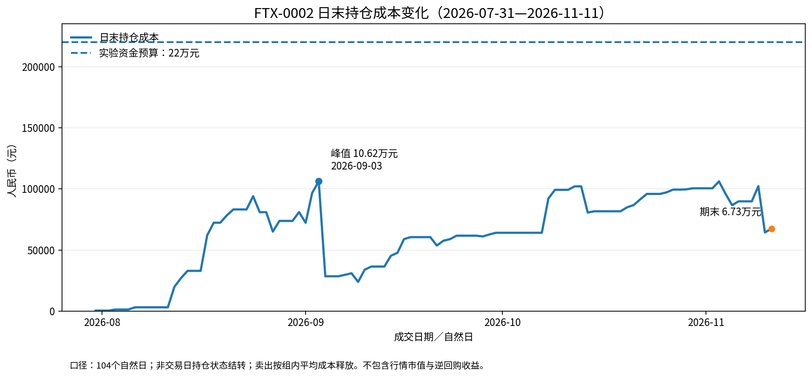

# 机会交易实验复盘（2026-07-31—2026-11-11）：20轮盈利与未结束头寸

截至2026年11月11日，[FTX-0002机会交易实验](/lab-fortune/experiments/ftx-0002-five-year-opportunity-experiment)已经完成20轮交易，全部实现盈利，累计净利润4,079.63元。

与此同时，还有8只证券尚未结束交易，持仓成本67,342.43元。按照11月11日的场内收盘价估算，这部分头寸存在1,670.23元的未实现亏损。

**已结束交易全部盈利，与整个实验的实际表现，并不是一回事。**

这次复盘利用152笔真实成交，观察资金如何投入、仓位如何变化，以及盈利和未结束头寸分别对实验产生了什么影响。

观察范围为2026年7月31日至11月11日。这只是FTX-0002持续实验的一次阶段性复盘。

本文的收益分析包含已实现交易利润及截止日未结束头寸的估算浮动盈亏，不包含逆回购收益，也没有扣除假设全部平仓时的未来交易费用。

## 一、实验背景：机会交易与资金预算

FTX-0002是一项持续进行的机会交易实验。

主要思路是：当市场或某只证券出现较大幅度调整时，观察是否存在值得参与的修复机会，在控制仓位的前提下分批买入，并等待合适的退出时机。

实验预留的最大资金预算为22万元。

这笔资金是预算上限，不是必须完成的投入目标。没有合适机会时，可以暂时保留现金，未使用部分也可以参与逆回购。

实验还有一项基本原则：

**达到预先设定的最大仓位后，不再继续加仓。**

但设置最大仓位，只解决了最多投入多少的问题。

首次买入应该投入多少？后续下跌时如何分配资金？什么时候停止加仓？什么时候退出？一笔原本等待价格修复的交易，如果持有了两个月，是否仍应继续等待？

这些问题值得通过实际交易记录进行研究。

## 二、数据来源与统计口径

本次使用FTX-0002交易系统导出的原始成交和机会交易汇总记录。

为便于复核，已将本次导出数据随文保存：[下载交易数据（ZIP，内含JSON文件）](/lab-fortune/experiments/ftx-0002-docs/data/ftx-0002-export-20261112-212007.zip)。压缩包包含152笔原始成交、20轮已结束交易汇总及数据获取清单。

附件为2026年11月12日导出的数据快照，本文分析的成交日期范围为2026年7月31日至11月11日，不随后续交易自动更新。用于期末估值的历史场内收盘价来源另见文末。

| 数据项目 | 结果 |
|---|---:|
| 观察起始日期 | 2026-07-31 |
| 观察结束日期 | 2026-11-11 |
| 原始成交 | 152笔 |
| 买入成交 | 127笔 |
| 卖出成交 | 25笔 |
| 涉及证券 | 17只 |
| 已结束交易 | 20轮 |
| 尚未归集成交 | 47笔 |

分析前已经核对分页完整性、重复ID、成交与汇总的关联关系，以及各轮买卖金额、数量、费用和净利润的一致性。

本次数据完整性校验通过。

### 统计口径

**已实现净利润：** 使用系统已结束交易汇总中的利润，并核对卖出金额减去买入金额及全部交易费用。

**持仓成本：** 根据原始成交重建剩余份额，买入成本包含买入费用，卖出时按对应交易组的平均成本释放持仓成本。

**资金占用：** 采用每个自然日日末尚未释放的持仓成本，不使用累计买入金额或证券市值代替。

**平均资金占用：** 对2026年7月31日至11月11日、含首尾共104个自然日的日末持仓成本取简单平均，非交易日沿用前一个交易日状态。

**未实现盈亏：** 按11月11日场内收盘价乘以剩余份额，减去包含买入费用的持仓成本。

已结束交易的持有自然日、未结束头寸的最早持有天数，均采用包含首尾日期的口径。

本次只分析成交日期，不重建日内成交顺序。对于同日完成买卖的交易，日末持仓可能为零，因此基于日末数据的资金占用指标无法反映其日内实际投入。

## 三、资金使用：22万元预算，实际占用了多少？

按照每日剩余持仓成本重建资金变化，得到以下结果：

| 指标 | 金额 |
|---|---:|
| 实验资金预算 | 220,000.00元 |
| 历史最高日末占用 | 106,240.02元 |
| 最高占用日期 | 2026-09-03 |
| 104个自然日平均占用 | 63,347.43元 |
| 2026-11-11期末占用 | 67,342.43元 |

历史最高日末占用相当于总预算的48.29%，平均占用相当于28.79%。

平均占用和期末占用虽然数值接近，但前者是104个自然日的平均值，后者是11月11日单日的持仓成本。

### 资金占用的变化

| 日期 | 日末持仓成本 |
|---|---:|
| 2026-07-31 | 441.52元 |
| 2026-08-31 | 81,022.35元 |
| 2026-09-03 | 106,240.02元 |
| 2026-09-30 | 64,097.26元 |
| 2026-10-30 | 100,491.56元 |
| 2026-11-11 | 67,342.43元 |

*图1：7月31日至11月11日的日末持仓成本。预算参考线为22万元，9月3日达到本期最高日末占用约10.62万元。*

8月至9月初，持仓逐步增加；9月3日达到观察期峰值；随后部分交易结束，资金占用下降。

10月底，资金占用再次接近10万元。进入11月后，随着部分交易退出，期末占用回落至约6.73万元。

这说明实验中的资金已经经历多次投入、退出和重新投入，并非持续单向加仓。

### 总体占用与单品种集中度

9月3日，主要持仓成本为：

| 证券 | 日末持仓成本 |
|---|---:|
| 酒ETF鹏华 | 55,624.10元 |
| 日经225ETF易方达 | 24,466.70元 |
| 双汇发展 | 16,728.42元 |
| 陕西能源 | 9,420.80元 |

其中，酒ETF鹏华占当日全部持仓成本的52.36%，占22万元实验预算的25.28%。

这两个比例反映了不同的问题。

占预算比例关系到单品种的绝对投入规模；占当前持仓比例反映资金是否集中在少数证券。

所以，即使整体资金占用不到预算的一半，也有必要单独观察仓位集中度。

## 四、交易行为：20轮盈利是怎样形成的？

截至11月11日，系统已经结束20轮交易。

| 指标 | 金额 |
|---|---:|
| 累计买入金额 | 276,669.50元 |
| 累计卖出金额 | 280,797.70元 |
| 累计交易费用 | 48.57元 |
| 已实现净利润 | 4,079.63元 |

累计买入金额是20轮交易的总成交规模，并不代表同时投入了27.67万元。

同一笔本金可以在交易结束后重新投入，因此累计买入金额可能超过实际同时占用的资金。

### 相近的利润，不同的资金使用过程

选择三轮交易进行比较：

- 酒ETF鹏华：本期净利润最高的一轮。
- 日经225ETF易方达：净利润第二高，但只持有3个自然日。
- 法国ETF华安：全部已结束交易中持有时间最长的一轮。

| 证券 | 累计买入金额 | 持有自然日 | 净利润 |
|---|---:|---:|---:|
| 酒ETF鹏华 | 55,621.60元 | 23天 | 620.07元 |
| 日经225ETF易方达 | 24,465.60元 | 3天 | 612.17元 |
| 法国ETF华安 | 40,181.40元 | 61天 | 302.95元 |

酒ETF与日经225ETF的净利润只相差7.90元，但两轮交易的资金投入和持有时间差异明显。

进一步按照各轮持有期间的日末持仓成本计算：

| 指标 | 酒ETF鹏华 | 日经225ETF易方达 |
|---|---:|---:|
| 持有自然日 | 23天 | 3天 |
| 日末仍有持仓的天数 | 22天 | 2天 |
| 有持仓日期的平均日末成本 | 42,906.39元 | 24,466.70元 |
| 已实现净利润 | 620.07元 | 612.17元 |

酒ETF于8月13日开始本轮建仓，随后分批追加，8月24日完成最后一次买入，9月4日全部卖出。

日经225ETF则在9月2日完成本轮全部买入，9月4日卖出。

两轮交易的卖出日日末持仓均为零，因此表中的平均成本仅统计日末仍持仓的日期。

如果计算全部持有期间的日末成本累计值，酒ETF为943,940.61元·自然日，日经225ETF为48,933.40元·自然日。这项指标衡量日级别的资金占用总量，不等于实际发生的融资利息或机会成本。

**两轮交易的利润金额几乎相同，但酒ETF占用了更多资金，也持续了更长时间。**

这说明，利润金额与资金使用效率需要分开评价。

不过，资金使用效率也不是唯一评价标准。交易期间的价格波动、潜在回撤和资金约束，同样会影响交易质量。

### 已实现利润存在集中度

20轮已结束交易的持有自然日中位数为13.5天。

其中，净利润最高的三轮分别为：

| 证券 | 净利润 |
|---|---:|
| 酒ETF鹏华 | 620.07元 |
| 日经225ETF易方达 | 612.17元 |
| 沙特ETF南方 | 512.66元 |
| **合计** | **1,744.90元** |

三轮合计贡献全部已实现净利润的42.77%。

其余17轮合计盈利2,334.73元，平均每轮137.34元。

未来可以进一步研究：利润较高的交易，是否也承担了更长时间、更大仓位或更高价格波动所带来的风险。

## 五、未结束头寸：资金集中与真实浮动盈亏

截至11月11日，还有47笔尚未归集的成交，全部为买入，涉及8只证券。

期末持仓成本合计67,342.43元。

### 期末8只证券

| 证券 | 持仓成本 | 占期末成本 | 最早买入日 | 已持有自然日 |
|---|---:|---:|---|---:|
| 沙特ETF南方 | 32,550.87元 | 48.34% | 09-07 | 66 |
| 沪深300ETF易方达 | 12,051.54元 | 17.90% | 11-11 | 1 |
| 日经225ETF易方达 | 4,830.02元 | 7.17% | 10-15 | 28 |
| 创业板50ETF华安 | 4,719.81元 | 7.01% | 10-21 | 22 |
| 标普油气ETF富国 | 4,020.97元 | 5.97% | 11-04 | 8 |
| 巴西ETF易方达 | 3,762.17元 | 5.59% | 10-27 | 16 |
| 南方原油LOF | 3,303.35元 | 4.91% | 11-10 | 2 |
| 纳斯达克ETF华夏 | 2,103.70元 | 3.12% | 11-03 | 9 |
| **合计** | **67,342.43元** | **100%** | — | — |

*持有天数以最早买入日至11月11日计算，包含首尾。沪深300ETF易方达是在11月11日新建的仓位，其17.90%的占比反映的是新近投入。*

沙特ETF占期末已投入资金的48.34%，占22万元总预算的14.80%。

这里的48.34%与第三节最高占用占预算的48.29%，分母不同。

### 沙特ETF：17笔买入的资金与价格分布

尚未结束的沙特ETF头寸从9月7日开始建立。

截至10月30日，共发生17笔买入：

- 累计买入金额：32,549.40元。
- 买入手续费：1.47元。
- 含费用成本：32,550.87元。
- 累计买入份额：36,500份。

分段统计如下：

| 时间 | 笔数 | 买入金额 | 金额占比 | 加权买入均价 |
|---|---:|---:|---:|---:|
| 09-07至09-10 | 4 | 13,537.70元 | 41.59% | 0.90857元 |
| 09-11至09-30 | 9 | 13,416.50元 | 41.22% | 0.89443元 |
| 10-09至10-30 | 4 | 5,595.20元 | 17.19% | 0.84776元 |
| **合计** | **17** | **32,549.40元** | **100%** | **0.89176元** |

加权均价按照成交金额除以成交份额计算。

9月份13笔买入占总金额的82.81%，加权均价约0.90148元。

10月份4笔买入占17.19%，加权均价约0.84776元。

**沙特ETF的买入资金主要集中在9月份，当月平均成交价比10月份高约5.96%。**

其中，9月10日一笔买入11,000份，成交价格0.907元，金额9,977元，占这17笔总买入金额的30.65%。

其余16笔成交金额的中位数为1,329.70元，单笔金额范围为568.40元至2,857.80元。

9月10日的金额约为其余16笔中位数的7.50倍，属于规模明显较大的一笔买入。

10月26日，又以0.785元成交买入1,000份。这是本次17笔买入记录中的最低成交价，较9月份的加权均价0.90148元低约12.92%。

到11月11日，沙特ETF的场内收盘价为0.843元，相比10月26日的那笔买入价格回升约7.39%。

但相对于整批36,500份的含费用持仓成本，期末仍浮亏1,781.37元，浮亏比例约5.47%。

这组数据反映了一个实际过程：较多资金在9月份投入，10月份仍出现了明显更低的买入价格，随后价格有所回升，但整批持仓尚未恢复至成本水平。

### 是资金分配失衡，还是主动控制风险？

从事后数据看，前期投入占比较大，后续更低成交价格阶段投入较少。

但能否将这一结构评价为资金分配失衡，还需要结合当时的交易计划。

实验有达到最大仓位后不再加仓的原则，但现有成交记录没有保存沙特ETF在9月10日之前明确设定的单品种资金上限及每层资金分配金额。

因此，无法确认9月10日的较大买入是否符合当时计划，也无法从后续买入金额减少这一现象，判断是主动停止加仓，还是剩余预算受到约束。

**本次能确定的是成交行为，尚无法完整还原当时的决策依据。**

下一阶段最需要补充的，不是事后为交易寻找理由，而是在交易发生前记录计划仓位、加仓条件和停止加仓的依据。

只有这样，后续才能判断交易究竟是在执行既定策略，还是随着行情变化临时调整。

### 加入11月11日收盘价后的估值

本次补充了8只证券在2026年11月11日的场内收盘价，以统一时点计算尚未结束头寸的浮动盈亏。

| 证券 | 收盘价 | 持有份额 | 估算浮动盈亏 |
|---|---:|---:|---:|
| 沙特ETF南方 | 0.843 | 36,500 | −1,781.37元 |
| 沪深300ETF易方达 | 4.034 | 3,000 | +50.46元 |
| 日经225ETF易方达 | 2.116 | 2,300 | +36.78元 |
| 创业板50ETF华安 | 1.164 | 4,000 | −63.81元 |
| 标普油气ETF富国 | 1.255 | 3,200 | −4.97元 |
| 巴西ETF易方达 | 0.998 | 3,800 | +30.23元 |
| 南方原油LOF | 1.943 | 1,700 | −0.25元 |
| 纳斯达克ETF华夏 | 2.708 | 800 | +62.70元 |
| **合计** | — | — | **−1,670.23元** |

*浮动盈亏 = 11月11日场内收盘价 × 持有份额 − 含买入费用的成本。尚未扣除假设卖出时产生的费用。南方原油LOF的−0.25元接近持平。*

期末8只证券中，有4只浮盈、4只浮亏。

但浮亏并不是均匀分布的。

沙特ETF一只的浮亏达到1,781.37元，比8只证券合计的净浮亏1,670.23元还大。

其余7只证券的浮动盈亏相加为正111.14元，抵消了沙特ETF的一小部分损失。

因此，**本期未结束头寸的亏损主要集中在沙特ETF一只证券，而不是8只证券普遍出现了较大亏损。**

### 已实现与未实现结果合并观察

如果将已实现净利润和期末浮动盈亏放在一起：

| 项目 | 金额 |
|---|---:|
| 20轮已结束交易净利润 | +4,079.63元 |
| 8只未结束证券浮动盈亏 | −1,670.23元 |
| **合计** | **+2,409.40元** |

按这一估值口径，期末持仓市值为65,672.20元。

合计的正2,409.40元，相当于22万元实验预算的约1.10%，相当于本期日末平均占用成本63,347.43元的约3.80%。

这两个比例仅用于展示收益金额相对不同资金尺度的大小，不能直接视为正式投资收益率：总预算并未全部投入，平均日末成本也不包含全部现金流和日内资金占用。

本次观察期为104个自然日，不对上述比例进行年化。

### “20轮全部盈利”的样本偏差

现在可以用数据进一步观察这一问题。

已经结束的20轮交易全部盈利，但同一截止日还有未结束头寸存在浮动亏损，而且浮亏主要集中在沙特ETF。

如果实际交易习惯倾向于盈利后结束交易，而尚未达到退出条件的头寸继续持有，那么已结束交易样本就更容易集中盈利记录。

本次数据已经说明，仅用4,079.63元已实现利润评价实验，会遗漏尚未结束头寸的实际损益。

不过，要确定20轮全部盈利在多大程度上由退出规则造成，还需要进一步研究实际止盈条件、持仓期间的价格变化，以及这些未结束头寸最终怎样退出。

因此，未来评价机会交易策略，应将**已实现收益、未实现盈亏和资金占用**放在同一观察体系中。

## 六、下一阶段：三个改进方向

本次提出的改进均为待验证的实验假设。具体参数需要结合历史交易和后续执行结果比较，不能直接认定为最优交易规则。

### 1. 同时观察单品种绝对仓位和集中度

原有规则主要强调22万元总预算，以及达到预设最大仓位后不再加仓。

下一阶段可以进一步明确每只证券的候选投入上限，例如以总预算的20%至25%，即4.4万至5.5万元作为对照方案。

同时设置集中度复核条件：

**当总持仓成本达到4.4万元，且单只证券占全部持仓成本超过50%时，触发一次仓位检查。**

增加最低总持仓条件，可以避免实验早期因为只买入一只证券、投入几百元就触发无意义的集中度警报。

这一条件只用于复核，不自动产生卖出指令。

### 2. 加仓前检查剩余资金与停止条件

沙特ETF案例展示了单笔较大的买入，如何明显改变整个建仓阶段的资金分配。

未来每次加仓，可以固定记录：

- 本次买入对应什么价格条件或市场信号？
- 买入后已使用多少单品种预算？
- 继续下跌时准备如何安排剩余资金？
- 出现什么情况应当暂停加仓？

记录这些问题的目的，不是要求机械地分批买入。

而是让每次追加投入都有明确依据，并保留后续复盘所需要的事前信息。

下一阶段重点比较**事前计划与实际执行之间的差异**。

### 3. 建立持有时间复核机制

20轮已结束交易的持有自然日中位数为13.5天，而沙特ETF尚未结束头寸的最早一笔已经持有66天。

可以考虑在持有15天、30天、60天时进行复核。

复核时重新回答：

最初买入的依据是否仍然成立？当前持有仓位是否合理？如果没有持仓，现在是否仍愿意按照相同条件买入？

复核不等于必须卖出，也不意味着持有时间越长就越不合理。

它的目的，是区分有意识的等待与缺少重新判断的持续持有。

## 七、结语

本次观察期内，FTX-0002共有152笔成交，20轮已结束交易实现净利润4,079.63元；期末8只未结束证券按11月11日收盘价估算浮亏1,670.23元，二者合计为正2,409.40元，尚未计入现金管理收益。

这次最值得关注的发现，是单品种仓位在部分时点较为集中，沙特ETF的买入资金主要集中在9月份，以及已结束交易与未结束头寸呈现出不同的损益状态。

下一次复盘，需要继续回答三个问题：

**仓位管理是否更加明确？加仓和停止加仓是否按照事前计划执行？持有时间复核是否改善了资金配置与退出决策？**

持续复盘的意义，不是证明过去每一笔交易都正确，而是让真实成交逐渐成为下一次决策的依据。

### 数据来源

**交易记录**

FTX-0002机会交易系统导出的152笔原始成交及20轮已结束交易汇总，观察范围为2026年7月31日至11月11日。

**历史场内收盘价**

以下页面用于核验2026年11月11日的二级市场收盘价，而非基金单位净值：

| 证券代码 | 证券 | 历史行情 |
|---|---|---|
| 159329 | 沙特ETF南方 | [Investing.com](https://cn.investing.com/etfs/159329-historical-data) |
| 510310 | 沪深300ETF易方达 | [Investing.com](https://cn.investing.com/etfs/e-fund-seeded-csi-300-historical-data) |
| 513000 | 日经225ETF易方达 | [Investing.com](https://cn.investing.com/etfs/513000-historical-data) |
| 159949 | 创业板50ETF华安 | [Investing.com](https://cn.investing.com/etfs/159949-historical-data) |
| 513350 | 标普油气ETF富国 | [Investing.com](https://cn.investing.com/etfs/513350-historical-data) |
| 520870 | 巴西ETF易方达 | [Investing.com](https://hk.investing.com/etfs/520870-historical-data) |
| 501018 | 南方原油LOF | [HaoETF](https://www.haoetf.com/qdii/501018) |
| 513300 | 纳斯达克ETF华夏 | [Investing.com](https://cn.investing.com/etfs/513300-historical-data) |

**统计限制**

资金占用按104个自然日的日末剩余成本统计，非交易日持仓结转；未实现盈亏为截止日收盘价估值，不等于最终平仓盈亏；未纳入逆回购收益和未来卖出费用。

本文是个人交易实验记录，不构成投资建议。
