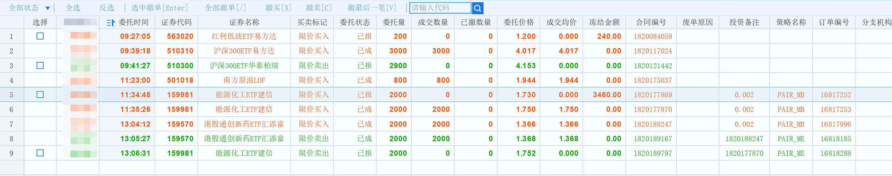

# 从零打通 Java、Python 与 QMT 的真实证券交易链路

最初做 T 时，我需要自己观察行情、提交委托、等待成交，再手动挂出反向委托。

这个过程并不复杂，却需要人不断关注交易状态。

后来，我开始尝试通过程序解决这个问题：**第一笔交易由程序发起，成交以后，再利用券商的回调机制自动提交第二笔反向委托。**

本文记录的，就是这条真实证券交易链路从人工操作到程序化执行的实现过程。

关于为什么开始自己开发证券软件，可以先阅读[《为什么我开始自己开发证券软件？》](/securities/why-i-built-it)。

## 一、从人工做 T 开始

最初，我使用券商提供的交易软件进行做 T 操作。

打开软件，查看行情、分时图和 K 线，在不同证券品种之间观察、筛选，寻找可能的交易机会。

当我认为某个品种适合交易时，就直接在券商软件中手动提交第一笔买入或卖出委托。

一笔最基本的证券委托，需要明确四个要素：

1. **证券代码**：交易哪个证券品种。
2. **交易方向**：买入还是卖出。
3. **委托价格**：希望以什么价格交易。
4. **委托数量**：希望交易多少份。

例如，假设准备买入某只 ETF，提交这样一笔委托：

| 要素 | 第一笔委托 |
|---|---|
| 证券代码 | 159605.SZ |
| 交易方向 | 买入 |
| 委托价格 | 1.200 元 |
| 委托数量 | 2000 份 |

提交以后，需要等待这笔委托真正成交。

有些券商软件会弹出成交提醒，有些可以通过手机通知。如果没有及时收到提醒，就只能不断查看成交记录，确认是否已经成交。

一旦发现成交，就需要计算反向委托的价格，并再次手动下单。

假设第一笔最终以 1.200 元全部成交，预先希望获得 0.002 元的价差，那么反向委托就是：

| 要素 | 第二笔委托 |
|---|---|
| 证券代码 | 159605.SZ |
| 交易方向 | 卖出 |
| 委托价格 | 1.202 元 |
| 委托数量 | 2000 份 |

如果第一笔是卖出，那么第二笔就需要反向买入，价格则相应减去预设价差。

关于价差为什么能够产生收益，我在[《为什么一厘价差也能产生收益？——做 T 的数学基础》](/lab-fortune/lab-zuot/basics/math-foundation)中已经讨论过。

但实际操作时，我面临的是另一个问题。

**第一笔什么时候成交，并不由我决定。**

可能几分钟就成交，也可能需要等待更长时间。

而成交以后，还需要及时发现、计算价格、填写委托信息。

如果当时没有关注交易软件，反向委托就可能被耽误。

于是，我开始考虑：

**能不能让程序代替人工完成这些重复操作？**

要实现这个目标，首先需要解决两个问题。

第一，怎样通过程序向券商发起第一笔真实委托？

第二，第一笔成交后，怎样让程序自动提交反向委托？

至于第一笔交易应该在什么位置发起，则是另一个问题，可以参考[《为什么第一笔交易最难？》](/lab-fortune/lab-zuot/basics/why-first-trade-is-hard)。本文主要讨论交易的程序化执行。

## 二、怎样通过程序发起第一笔委托？

我主要使用 Java 进行软件开发，因此希望继续使用 Java 组织交易业务。但要让程序真正完成证券委托，就需要接入券商提供的交易接口。

当时，我了解过 PTrade 和 MiniQMT 两种程序化交易工具。它们的开通条件有所不同，结合当时的实际情况，MiniQMT 的开通相对简单，也能够满足我的需求，因此最终选择了 MiniQMT。

QMT 是迅投提供的量化交易系统。MiniQMT 是其轻量化客户端，可以通过 XtQuant 提供的 Python API，访问账户查询、委托交易和交易回调等能力。

> 官方文档：https://dict.thinktrader.net/nativeApi/start_now.html

问题也随之出现：

**我的业务程序使用 Java，而所选择的 MiniQMT 接入方式需要通过 Python 调用。**

如果完全使用 Python 重写交易业务，并不是我希望采用的方式。

我更希望保留 Java 作为业务开发语言，只让 Python 负责与 MiniQMT 交互。

### 将 Python 封装为 Web 服务

为了解决 Java 与 Python 之间的调用问题，我采用了 HTTP 服务的方式。

使用 Flask / FastAPI 将 Python 程序封装成独立的 Web 应用，对外提供委托、撤单、查询等接口。

Java 程序只需要通过 HTTP 请求，就可以调用 Python 服务，再由 Python 调用 XtQuant 完成券商交易操作。

整体关系如下：

```text
Java 业务程序
      │
      │ HTTP 请求
      ▼
Python Web 服务
（Flask / FastAPI）
      │
      │ XtQuant
      ▼
MiniQMT
      │
      ▼
券商交易系统
```

这种方案不需要让 Java 直接了解 XtQuant 的调用细节，也不必把全部交易业务迁移到 Python 中。

Python 在这里主要承担的是**券商接口适配层**的职责。

Java 负责发起交易请求，Python 负责把请求转换成 MiniQMT 能够执行的操作。

### 视频演示：使用 curl 下单与撤单

当时，我还专门录制过一段操作视频，用 curl 调用 Python HTTP 接口，演示 ETF 下单与撤单，并在券商客户端中查看委托和撤单结果。

- [随便发点。使用 curl 下单与撤单 ETF（B 站视频）](https://www.bilibili.com/video/BV1dtdZYNEKn/)

curl 在这里充当 HTTP 客户端，用来验证服务接口能否完成实际操作。接口打通以后，Java 程序也可以通过 HTTP 请求调用这些能力。

这段视频记录的是当时的接口与操作流程，可以对照理解请求如何传递到交易客户端。后来我调整过接口 URL，因此视频中的地址可能与当前实际使用的地址不同，请以实际部署的接口为准。首笔成交后怎样自动生成反向委托，则在后文继续说明。

### 为什么还需要鉴权？

将 Python 封装成 HTTP 服务以后，还会带来一个新的问题：接口访问安全。

因为这些接口能够操作真实证券账户，不是普通的数据查询接口。

如果未经授权的请求也能访问，就可能产生真实的证券委托。

因此，Python Web 服务需要具备身份鉴权，并限制能够调用交易接口的来源。可以通过接口签名、IP 白名单等方式建立访问边界，而不是直接暴露底层交易接口。

关于 Python HTTP 服务的封装、接口签名和访问控制，我在[《TdxQuant 实战（三）：封装内部行情服务》](/lab-technology/tdxquant/build-http-service)中有过专门讨论，这里不再展开具体实现。

虽然 TdxQuant 主要用于行情数据，MiniQMT 用于真实证券交易，但在 Java 与 Python 的调用关系上，两者具有相似的工程思路。

至此，Java 已经能够通过 Python Web 服务向 MiniQMT 提交第一笔委托。

不过，第一笔委托发出以后，还没有解决自动反向交易的问题。

## 三、怎样知道第一笔委托已经成交？

这里需要先区分两个概念：

**委托提交成功，不等于委托已经成交。**

例如，程序向券商提交一笔 1.200 元的买入委托。

如果当前市场没有满足这个价格的成交条件，这笔委托就可能一直处于等待状态。

因此，不能在提交第一笔委托以后，立即假设它已经成交，然后直接提交反向委托。

我需要的是：

**只有券商确认第一笔实际成交后，程序才执行下一步操作。**

关于一轮做 T 中委托、成交与反向交易之间的关系，可以参考[《一轮做 T 是怎样完成的？》](/lab-fortune/lab-zuot/engineering/how-a-t-trade-cycle-works)。

### 利用 XtQuant 的回调机制

XtQuant 交易接口提供了回调机制。

程序可以接收委托应答、委托状态变化和成交记录等信息。

异步下单返回的请求序号（`seq`）用于关联提交请求；委托状态回调中的 `order_sysid` 则是券商柜台侧的委托编号。当前程序生成反向委托时，使用后者保留与首笔委托的关联信息。

对于自动反向委托来说，当前实现中最关键的是 `on_stock_order` 委托状态回调。

程序收到回调以后，检查委托是否已经完成。

如果还在等待，就不触发反向委托。

如果只是部分成交，也不触发反向委托。

**只有首笔委托全部成交，并且符合预设的策略条件时，才自动提交第二笔委托。**

这样，原来需要人工反复查看成交记录的过程，就改成了由券商状态变化驱动程序执行。

## 四、怎样自动提交第二笔反向委托？

第一笔委托真正成交以后，第二笔交易仍然需要明确四个要素：

- **证券代码**：与第一笔相同。
- **交易方向**：与第一笔相反。
- **委托价格**：根据第一笔的实际成交均价和预设价差计算。
- **委托数量**：使用第一笔全部成交后的实际成交数量。

这里有一个细节：程序使用的是委托回报中的 `traded_price`，也就是实际成交均价，而不是直接使用最初的委托价格。

如果第一笔分多次成交，最终反向价格也是以全部成交后的均价为计算依据。

因此，在前面的例子中，程序可以从第一笔已成交的买入委托：

```text
证券代码：159605.SZ
交易方向：买入
成交均价：1.200
成交数量：2000
```

生成第二笔反向委托：

```text
证券代码：159605.SZ
交易方向：卖出
委托价格：1.202
委托数量：2000
```

如果第一笔是卖出成交，那么第二笔就是买入委托，价格按照预设价差向下计算。

不过，并不是账户中的所有成交都应该触发反向委托。

**程序怎么知道哪些委托需要自动反向交易？**

而且，第二笔成交后，也不应该继续生成第三笔、第四笔。

### 使用策略标识区分交易

XtQuant 的委托接口提供了策略名称和备注等字段，可以用于标识不同的交易。

由于字段长度有限，我采用简短的缩写，区分人工决定交易参数与自动策略决定交易参数，并标记一轮配对交易的开始和结束。

其中：

- **Manual**：人工决定证券、方向、价格和数量，再通过程序提交委托。
- **Auto**：程序根据预设策略自动决定交易参数并提交委托。

对应的策略标识如下：

| 策略标识 | 完整含义 | 作用 |
|---|---|---|
| `PAIR_MB` | Pair Manual Begin | 人工决定参数的配对首单 |
| `PAIR_ME` | Pair Manual End | 对应的反向委托 |
| `PAIR_AB` | Pair Auto Begin | 自动策略发起的配对首单 |
| `PAIR_AE` | Pair Auto End | 自动策略首单对应的反向委托 |

其中，`PAIR` 表示配对交易，`B` 是 Begin（开始），`E` 是 End（结束）。

例如，使用 `PAIR_MB` 提交第一笔委托。

当这笔首单全部成交后，程序根据回调信息生成反向委托，并将第二笔标记为 `PAIR_ME`。

对于自动策略发起的首笔委托，则使用 `PAIR_AB`，对应的反向委托使用 `PAIR_AE`。

程序只有在识别到符合条件的首笔策略标识时，才会自动生成反向委托。

因此，当第二笔成交时，不会再次按照首笔委托的规则继续生成下一笔。

### 怎样关联第一笔与第二笔？

仅有策略标识，还不能区分同一个策略下的不同委托。

因此，生成反向委托时，程序会取得首笔委托的 `order_sysid`，并将其作为关联信息写入反向委托的备注。

这样，除了知道第二笔属于哪种策略，还保留了它与原始委托之间的关联线索。

由于委托备注存在长度限制，关联编号不能无限制写入。当前代码直接使用首笔委托的 `order_sysid`，尚未看到独立的长度校验逻辑。

这些策略标识和关联编号，在实际委托记录里是什么样的？



在这张截图中，**“策略名称”“投资备注”“订单编号”三列都有值的记录，是通过程序提交的委托；这三列均为空的记录，则是在券商软件中手工提交的委托。** 这是当前程序与这张截图中的区分方式。

这里的 `PAIR_MB` 虽然带有 Manual，但指的是人工决定交易参数，再由程序提交，并不是直接在券商软件里手工下单。

截图中的两组配对委托，可以分别看出不同的执行状态：

| 证券代码 | 首笔买入（`PAIR_MB`） | 反向卖出（`PAIR_ME`） | 当前状态 |
|---|---|---|---|
| 159570 | 以 1.366 元买入，已成交 2000 份 | 以 1.368 元卖出，已成交 2000 份 | 两笔均已全部成交，这一组配对买卖已经完成 |
| 159981 | 以 1.750 元买入，已成交 2000 份 | 以 1.752 元委托卖出 2000 份，成交数量为 0 | 反向委托已报，仍在等待成交 |

两组反向卖出的价格，都在首笔实际成交均价的基础上增加了预设的 0.002 元价差。

再对照编号就能看到：**每笔 `PAIR_ME` 委托的“投资备注”，都与对应 `PAIR_MB` 首笔委托的“合同编号”一致。** 首笔的投资备注记录预设价差，反向委托的投资备注则记录首笔合同编号；同一列在两个阶段承担不同的用途。

因此，查看这些记录时，既可以通过策略名称区分首笔与反向委托，也可以通过编号找到具体的配对关系，再结合委托状态和成交数量，判断这一组交易是否已经完成。

在现有实现中，这部分逻辑主要由 Python 服务完成。

Python 收到 XtQuant 的委托状态回调以后，判断策略类型，计算反向价格和数量，再调用交易接口提交反向委托。

于是，完整过程变成了：

```text
Java 发起第一笔委托
          ↓
Python 通过 XtQuant 下单
          ↓
MiniQMT 返回委托状态
          ↓
确认首笔委托全部成交
          ↓
Python 计算反向委托
          ↓
再次通过 XtQuant 下单
```

到这里，原本需要人工完成的等待成交、计算价格和提交反向委托，已经可以由程序处理。

### 实际交易制度的限制

需要注意的是，自动提交反向委托并不代表它一定能够成交，还要考虑证券交易制度与账户持仓。

例如，对实行 T+1 交易制度的股票，当天新买入的股份不能在当天卖出；如果账户原本持有可用底仓，则需要根据实际可用数量判断能否执行反向交易。

ETF 是否支持当日回转交易，也取决于具体品种。

因此，本文的程序化交易链路不能不加区分地直接套用到所有证券上。

关于不同证券的日内交易限制，可以进一步阅读[《T+0 与 T+1：为什么交易制度决定了做 T 的上限》](/lab-fortune/foundation/trading/t0-vs-t1)。

## 五、实际交易还有哪些问题？

程序化交易链路打通以后，并不意味着所有交易场景都已经解决。

例如，首笔委托可能只是部分成交。

目前的实现以**整笔委托全部成交**作为自动反向交易的触发条件。部分成交只进行提醒，不会立即提交反向委托。

如果委托部分成交后又撤销剩余数量，已成交的部分也不会由这条逻辑自动生成反向委托，需要另外处理。

此外，策略标识能够区分首笔委托和反向委托，但不能代替针对重复回调的幂等控制。当前检查的代码路径中，尚未看到独立的防重复执行机制。

程序断连、委托失败等异常，也需要结合实际运行情况处理。由于涉及真实资金，重复下单或遗漏反向委托都可能影响账户持仓。

因此，这套程序实现的是**自动提交委托和成交后的自动反向操作**，而不是保证每一轮交易都能成功闭合。

## 六、回头看这条交易链路

最初想解决的，只是第一笔委托成交以后，如何自动提交第二笔反向委托。

通过 Python Web 服务与 XtQuant 回调，这个需求有了可以实际运行的解决方案。

不过，完成程序化执行以后，我又逐渐发现：仅仅能够提交委托还不够。

交易发生以后，需要保存成交记录、关联首笔与反向交易，并判断一轮交易究竟有没有完成。

当一笔买入对应多笔卖出，或者一笔卖出对应多笔买入时，简单的配对方式也会逐渐遇到局限。

于是，需求开始从**如何执行交易**，进一步延伸到**如何记录、关联和管理交易**。

这也成为了后来开发证券成交中和模型的起点。
